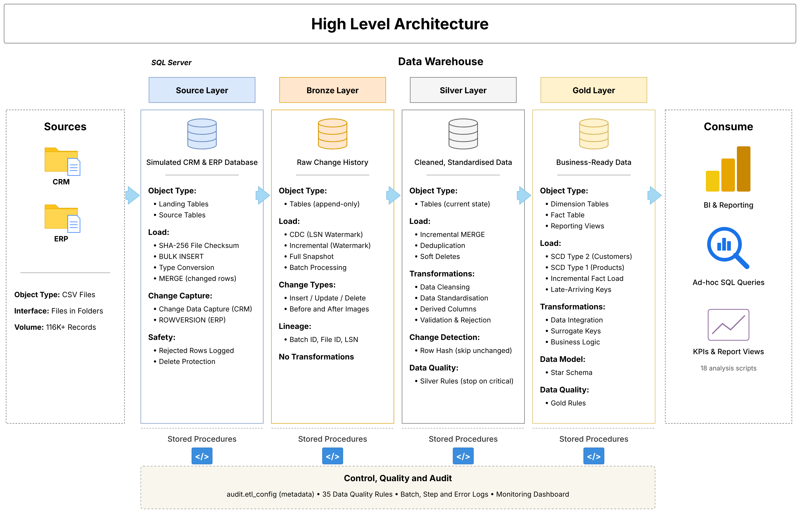
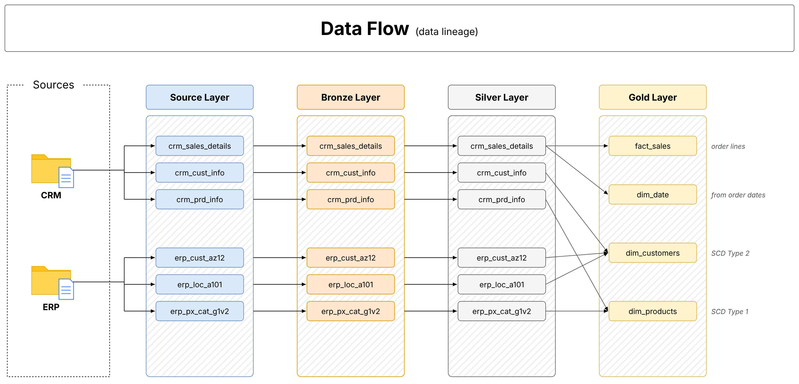
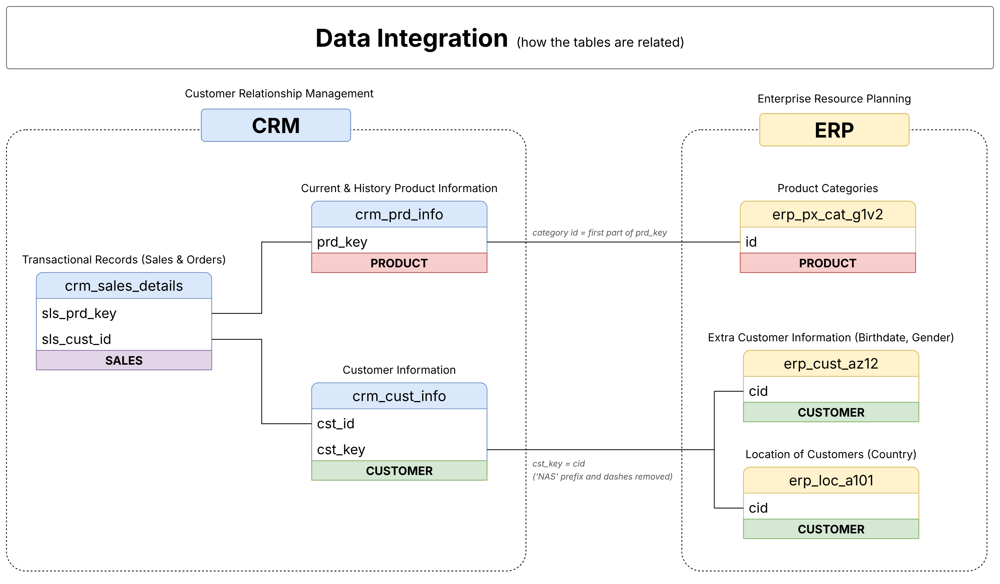
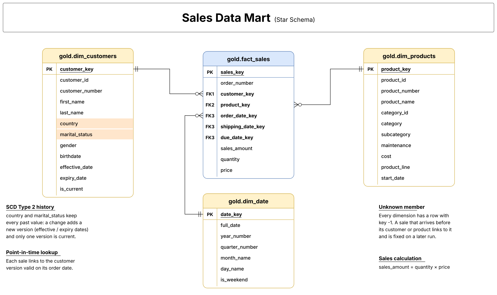

# Data Warehouse and Analytics System

A data warehouse built in SQL Server. It takes sales data from two systems (a CRM and an ERP), cleans it, keeps its history, and turns it into tables that are easy to report on.


---

## About the Project

Companies keep their data in many systems. To answer simple questions like *"How much did we sell last year, and to whom?"*, that data has to be brought together, cleaned and organised first. That is what a data warehouse does.

This project does it for six CSV files (about 18,500 customers, 400 products and 60,000 sales). It is built in four layers, where each layer makes the data a little better:

| Layer | What it holds |
|---|---|
| **Source** | The raw files, loaded into tables |
| **Bronze** | A full history of every change, never edited |
| **Silver** | Clean, corrected data |
| **Gold** | Final tables for reports and analysis |

**Main features**

- **Incremental loading with CDC and watermarks.** The CRM tables use SQL Server **Change Data Capture (CDC)**, which records every insert, update and delete. The ERP tables use a **watermark**: the pipeline saves the last loaded value (a ROWVERSION number), and the next run loads only rows above it. Each run loads only what changed, not everything.
- **Customer history with SCD Type 1 and Type 2.** **SCD Type 1** overwrites the old value and keeps only the latest one (used for corrections such as names). **SCD Type 2** keeps both: the old version is marked inactive (`is_current = 0`, with an `expiry_date`) and the new version is active (`is_current = 1`). It is used for country and marital status, so past sales keep the customer's old country.
- **Soft deletes.** A deleted record is flagged `is_deleted = 1` instead of being removed, so its history is not lost.
- **Star schema with surrogate keys.** The Gold layer has one fact table (`fact_sales`) linked to dimension tables (customers, products, dates). Each dimension row gets a **surrogate key**, an ID generated by the warehouse (such as `customer_key`), separate from the source ID.
- **Late-arriving data.** A sale that arrives before its customer or product links to an **Unknown member** (a row with key `-1`) and is fixed on a later run.
- **Data quality checks.** 35 rules check the data on every run. A critical failure stops the run before Gold is loaded.
- **Metadata-driven ETL.** One table, `audit.etl_config`, stores how each table is loaded (CDC, incremental or full), so changes need no code.
- **Audit logging.** Every run, step, error and rejected row is recorded.
- **Idempotent and tested.** Running the pipeline again with no new data changes nothing. 7 automated test suites check this and more.

---

## Architecture



---

## How the Data Moves



One command runs everything: `EXEC etl.usp_run_pipeline;`

1. **Load the files.** CSV files are loaded into the Source layer. A file whose checksum has not changed is skipped. Rows that cannot be read are rejected with a reason.
2. **Extract changes to Bronze.** Only changes after the watermark are copied, using CDC, ROWVERSION or a full snapshot. Bronze is never edited.
3. **Clean the data in Silver.** Duplicates are removed, values are fixed, codes become readable words, and deletes become soft deletes.
4. **Check Silver.** If a critical data quality rule fails, the run stops here.
5. **Build the Gold star schema.** Dimensions load first (with SCD Type 1 and 2), then the fact table.
6. **Check Gold and close the batch.** Each run ends as `SUCCESS`, `SUCCESS_WITH_WARNINGS` or `FAILED`.

**Examples of cleaning in Silver**

| Before | After |
|---|---|
| `M`, `S` (marital status) | `Married`, `Single` |
| `M`, `F` (gender) | `Male`, `Female` |
| `DE`, `US` | `Germany`, `United States` |
| `'  Jon '` | `'Jon'` |
| Wrong sales amount | `quantity × price` |
| Impossible date | `NULL` |

---

## How the Tables Connect

The CRM has sales, products and customers. The ERP adds product categories, birthdates, gender and country.



---

## Data Model

The Gold layer is a star schema: `fact_sales` in the middle, linked to three dimensions.



| Table | Type | One row for each |
|---|---|---|
| `fact_sales` | Fact | Item sold (order line) |
| `dim_customers` | Dimension, SCD Type 2 | Customer version (new version when country or marital status changes) |
| `dim_products` | Dimension, SCD Type 1 | Product |
| `dim_date` | Dimension | Day |

---

## Analysis Scripts

The `scripts/analytics/` folder has 18 SQL scripts that answer business questions.

| # | Script | What it shows |
|---|---|---|
| 01–04 | Exploration | Tables, countries, date range, and overall totals |
| 05 | Magnitude | Sales and customers by country and category |
| 06 | Ranking | Best and worst products and customers |
| 07 | Change over time | Sales by month and year |
| 08 | Cumulative | Running total of sales |
| 09 | Performance | Each product compared to its average and last year |
| 10 | Segmentation | Customer and product groups |
| 11 | Part-to-whole | Share of each category in total sales |
| 12 | Customer report | One summary row per customer |
| 13 | Product report | One summary row per product |
| 14 | Customer retention | Repeat customers and customers buying less |
| 15 | Product performance | Top products and products losing sales |
| 16 | Sales performance | Monthly and yearly growth |
| 17 | Business KPIs | Revenue, orders, average order value, growth |
| 18 | History | Sales by the customer's country then vs now |

Quick start queries:

```sql
SELECT * FROM gold.vw_kpi_summary;            -- main business numbers
SELECT TOP 10 * FROM gold.vw_sales_analysis;  -- sales with customer and product details
```

---

## How to Run

### With Docker (easiest)

You need Docker installed.

```bash
git clone https://github.com/UtkarshReddyNathala/Data-Warehouse-and-Analytics-System.git
cd Data-Warehouse-and-Analytics-System
cp .env.example .env          # then set MSSQL_SA_PASSWORD
./deploy/deploy.sh
```

This starts SQL Server, builds the warehouse and loads all the data. Then connect with SSMS or Azure Data Studio to `localhost,1433` with user `sa`.

### With your own SQL Server

You need SQL Server 2019 or newer (Developer, Standard or Enterprise edition) with SQL Server Agent running.

1. Copy the `data` folder somewhere SQL Server can read it, for example `C:\sql\dwh\data\`.
2. Run `scripts/init_database.sql`.
3. In SSMS, turn on **Query > SQLCMD Mode**, open `scripts/00_deploy_all.sql`, set `RepoRoot` and `DataRoot` at the top, and run it.
4. Run the pipeline: `EXEC DataWarehouse.etl.usp_run_pipeline;`

### Run the tests

```bash
./deploy/deploy.sh --no-reset --test
```

Or in SSMS (SQLCMD Mode), run `tests/run_all_tests.sql`. Use a development database only.

---

## Project Structure

```text
├── data/              # CRM and ERP CSV files
├── scripts/
│   ├── source/        # Loading the CSV files
│   ├── bronze/        # Change history
│   ├── silver/        # Cleaning
│   ├── gold/          # Final tables and views
│   ├── data_quality/  # The 35 quality rules
│   ├── audit/         # Logging
│   ├── metadata/      # The metadata table (audit.etl_config)
│   ├── cdc/           # Change tracking
│   ├── monitoring/    # Pipeline health queries
│   └── analytics/     # 18 analysis scripts
├── tests/             # 7 automated test suites
├── docs/              # Diagrams and detailed guides
└── deploy/deploy.sh   # One-command setup
```

---

## Tech Stack

SQL Server 2022 · T-SQL · Change Data Capture · SQL Server Agent · Docker · SSMS

---

## Learn More

Detailed guides are in the [`docs`](docs) folder:
[CDC](docs/cdc_implementation.md) ·
[Metadata-driven ETL](docs/metadata_driven_etl.md) ·
[Incremental loading](docs/incremental_loading.md) ·
[SCD Type 2](docs/scd_type_2.md) ·
[Data quality](docs/data_quality.md) ·
[Audit and monitoring](docs/audit_monitoring.md) ·
[Source-to-target mapping](docs/source_to_target_mapping.md) ·
[Data catalog](docs/data_catalog.md) ·
[Naming conventions](docs/naming_conventions.md) ·
[Testing](docs/testing.md) ·
[Performance](docs/performance.md) ·
[Detailed architecture diagram](docs/architecture/architecture.png)

---

**Author**: Utkarsh Reddy Nathala

**Linkedin**: https://www.linkedin.com/in/utkarshreddynathala/

**Contact**: utkarshnathala@gmail.com , 8977011784
